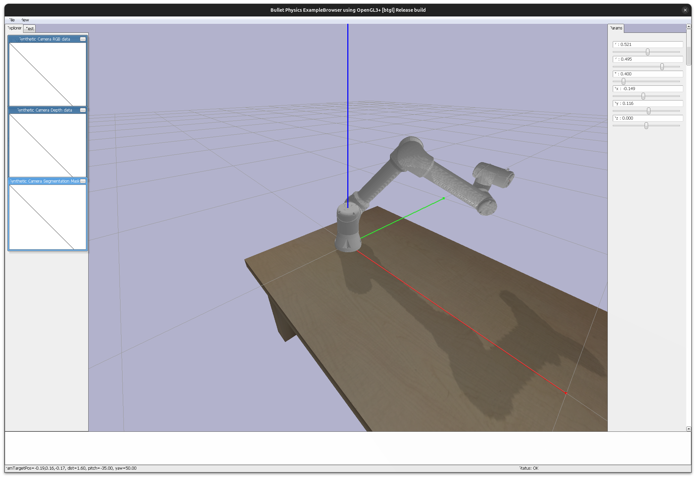

# UR5 Simulation

Implements a simulation of the UR5E in pybullet.

On docker (ubuntu24 with wayland):

```bash
xhost +local:docker
docker run -it --rm -v <repo>/:/ur5 -e DISPLAY=$DISPLAY -v /tmp/.X11-unix:/tmp/.X11-unix:ro --device /dev/dri python:3.6 bash
cd ur5 && pip3 install -r ./requirements.txt
python3 ./UR5/UR5Sim.py
```


